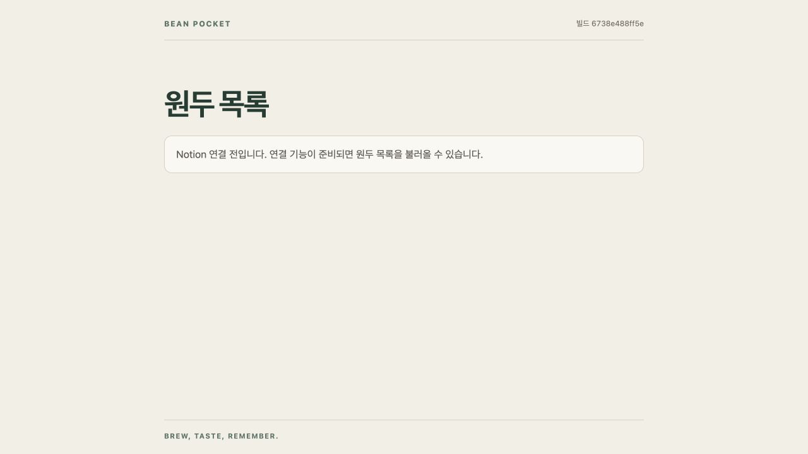

# T03 최소 PWA 첫 게시 — 완료

2026-10-18 (Asia/Seoul). 사용자가 직전 보고의 main 병합·첫 게시 요청에 “승인”이라고 답했다. 승인 범위의 5개 커밋을 기본 브랜치에 통합하고 첫 게시와 실제 HTTPS 확인을 수행했다.

| 항목 | 결과 |
|---|---|
| 실제 주소 | https://kangseokgyu.github.io/bean-pocket/ |
| 게시 소스 커밋 | `231f1d3e393b50c4877507ac4f081e2347fdab87` |
| 화면·산출물 빌드 | `6738e488ff5e` |
| 실행 | [39044921398](https://github.com/kangseokgyu/bean-pocket/actions/runs/39044921398) |
| 실행 시각 | 2026-10-18 00:24:42~00:25:13 KST |
| workflow 결과 | success. build 9초, deploy 12초 |
| CI 검증 | 전체 테스트 40 통과·0 실패, 빌드·산출물 검사 통과 |
| 실제 자원 | 프로젝트 루트와 index.html·JS·CSS·manifest·SW·PNG 2개 모두 HTTP 200, 승인 산출물과 바이트 일치 |
| PC 화면 | 제목·연결 전 안내·빌드 버전 정상, 새로고침과 index.html → 프로젝트 루트 복귀 정상 |
| 아이폰 | 사용자에게 URL·실행 절차 전달. T04 검증 대기 |

## 통합 경계

작업 전 로컬 main은 과거 보존 이력 `b87ebc4`였고 origin/main은 새 초기 이력 `4561a9e`였다. 과거 로컬 main을 `codex/local-main-before-pages`로 이름 변경해 보존하고, 원격 main 기준으로 로컬 main을 다시 만들었다. `origin/main`이 작업 브랜치의 조상임을 확인한 후 fast-forward로 검토된 커밋만 통합했다. 강제 push나 이력 삭제는 하지 않았다. 원격에는 main과 이번 작업 브랜치만 push했으며 과거 로컬 보존 브랜치는 게시하지 않았다.

게시 이후 이 실행 증거와 T04 체크리스트를 별도 문서 커밋으로 남긴다. 이 보고용 커밋은 앱 소스·빌더·배포 파일을 변경하지 않으므로 게시 커밋과 최신 문서 커밋을 구분한다.

## 실행 명령과 증거

- `git merge-base --is-ancestor origin/main codex/pages-first-implementation`: 종료 0.
- `git merge --ff-only codex/pages-first-implementation`, `git push origin codex/pages-first-implementation main`: 종료 0.
- `gh workflow run pages.yml --ref main`: 종료 0.
- `gh run watch 39044921398 --exit-status --interval 10`: 종료 0, build/deploy 모두 success.
- `gh run view 39044921398 --log`: 종료 0. [CI 핵심 결과](ci-summary.txt). 전체 로그의 로컬 보관 경로는 `/private/tmp/bean-pocket-first-pages-ci.log`이며 임시 파일이다.
- Node fetch로 HTTPS 8개 경로의 status·Content-Type·SHA-256·로컬 승인 dist와 바이트 일치를 검사: 종료 0. [결과](http-resources.json).
- Codex in-app browser에서 실제 URL → index.html → 프로젝트 루트 → 새로고침 순서로 화면 확인. 최종 표시 버전 `6738e488ff5e`.

Actions가 일부 공식 Pages action의 Node 20 선언을 Node 24로 실행한다는 전환 경고와 ubuntu-latest 이미지 변경 예고를 출력했으나 실행 실패는 없었다. 이번 게시에서 기능 코드나 workflow를 추가 변경하지 않았다.

Notion 직접 조회·쓰기와 실제 아이폰 Safari·홈 화면 실행, 파일 저장 수명은 검증하지 않았다. 첫 화면은 연결 전 안내이며 Notion 연결 성공을 뜻하지 않는다. M1은 T04 실기기 결과를 받아야 완료된다.
