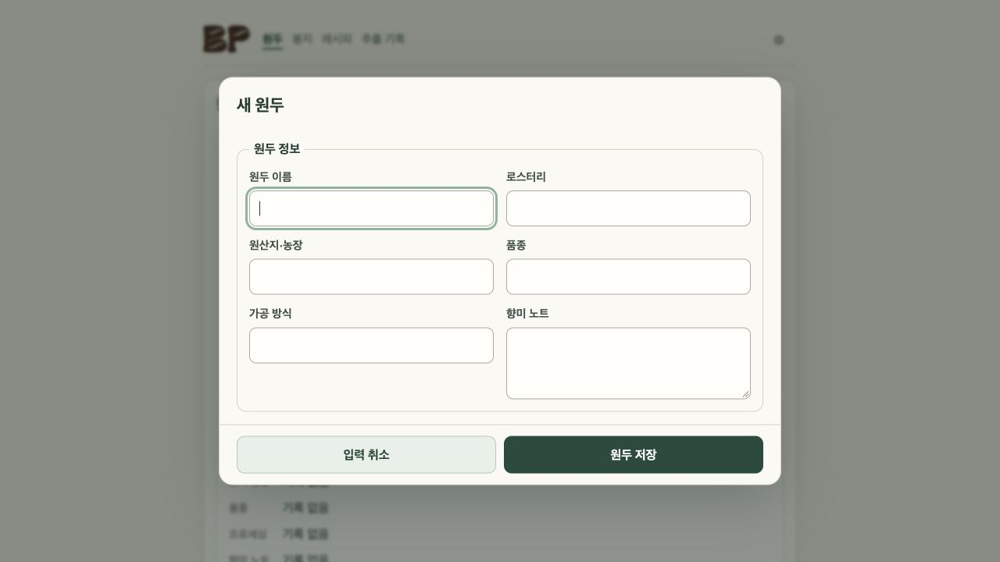

# 추가 입력 모달 — 2026-10-25

원두·봉지·레시피·추출기록 추가 폼을 모달로 변경했다. 하단 저장·취소 버튼, 저장 중 스피너와 중복 제출 차단, 성공 체크 후 1000ms 자동 닫힘, 오류 시 입력 보존과 재시도를 지원한다. 성공 대기 중 입력·단계 편집도 잠근다. Escape·포커스 복귀·내부 스크롤과 모션 감소 설정을 고려했다.

- 기능 커밋: `b188d04`, 리뷰 보완: `8edcac6`, 최신 main 통합: `ed80361749c1114e16d3fae72f99f9a5a8c68301`.
- Worker: gpt-6-luna / max, 별칭 Leibniz. Critic: gpt-6.1-sol / medium, 별칭 Helmholtz. 이름 지정 도구 미지원으로 역할과 별칭을 대응했다.
- 독립 리뷰: 성공 대기 중 입력 유실·dirty 잔류 및 reduced-motion 우선순위 문제를 발견해 수정하고, 통합본 ed80361 재검토 승인.
- 테스트 선행 실패 후 구현. 통합 focused 87/87, 원본 Critic 재현 2/2 통과. main 통합 후 `npm test` 471/471, `npm run build:pages`, `npm run check:pages` 모두 exit 0. 로그는 이 폴더에 보관했다.
- Worker CUA: 모의 저장으로 pending/failure/retry/success/1000ms close/성공 입력 잠금/Escape/focus/모바일 확인. 통합본 390×844에서 로고·내비·추출 가이드 공존 확인. `browser.json` 참조.
- 일반판 Pages 워크플로 `pages.yml`, `probes=false`, [실행 40169329386](https://github.com/kangseokgyu/bean-pocket/actions/runs/40169329386) 성공. `deployment.json` 참조.
- 공개 주소: https://kangseokgyu.github.io/bean-pocket/
- 공개 빌드: `897576251763`. 일반판 파일 20개 모두 HTTP 200 및 로컬 dist 바이트 일치. `published-files.json` 참조.
- 공개 CUA에서 네 종류 모두 모달·하단 저장/취소 표시, 취소 후 닫힘·호출 버튼 포커스 복귀 확인. 화면에 빌드 897576251763 표시 확인. 실제 Notion 쓰기는 실행하지 않았다.
- 미검증: 실제 Notion 저장, 실제 iPhone Safari/홈화면 실행, OS reduced-motion 미디어 실행. 모션 감소는 CSS 회귀 테스트로 확인했다.

