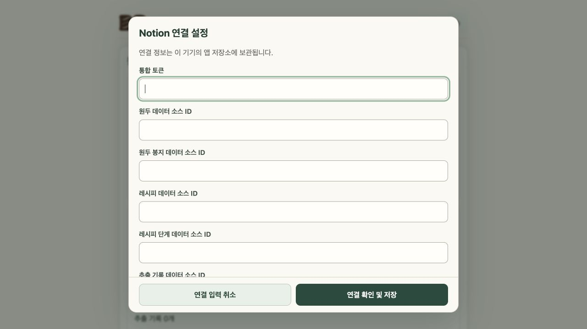

# 연결 설정 모달 — 2026-10-25

설정 버튼의 연결 정보 입력 화면을 모달로 전환했다. 하단 연결 확인 및 저장·취소 버튼, 검증/저장 중 표시와 전체 입력 잠금, 성공 체크 후 1000ms 닫힘, 실패 후 입력 보존/재시도를 지원한다. 취소·Escape 시 입력한 secret과 dirty 상태를 정리하고 설정 버튼으로 포커스를 복귀한다. 초기 연결·저장소 재시도·복구 안내 흐름을 보존한다.

- 브랜치: `codex/connection-settings-modal`, 기능 `b34552a`, 최신 main 통합 `f14197f`, 리뷰 보완 및 게시 커밋 `390bcf9466574ab19982ffef575bd3a45a66aef8`.
- Worker: gpt-6-luna / max (Leibniz), Critic: gpt-6.1-sol / medium (Helmholtz). 기존 에이전트 재사용.
- 독립 리뷰에서 느린 목록 조회 후 포커스 복귀 누락을 발견, 테스트 선행으로 재현 후 수정했다. 성공 후 1000ms 닫힘을 유지하고 버튼 활성화 시 1회 포커스를 복귀한다. 보완 후 Critic 승인.
- 관련 focused 89/89, 전체 483/483 통과. main 통합 후 `npm test`, `npm run build:pages`, `npm run check:pages` 모두 exit 0. 이 폴더의 로그 참조.
- CUA 모바일 모의 연결 검증: 실패/재시도, 저장 중 및 성공 단계 전체 잠금, 1초 닫힘, Escape 취소와 포커스, 느린 조회 후 포커스 복귀. `browser.json`, `focus-browser.json` 참조.
- 공개 주소: https://kangseokgyu.github.io/bean-pocket/
- 일반판 빌드: `51fe88622b62`, `pages.yml` 수동 실행 `probes=false`.
- [Pages 실행 40193301446](https://github.com/kangseokgyu/bean-pocket/actions/runs/40193301446). 게시 결과·공개 파일 비교는 `deployment.json`, `published-files.json` 참조.
- 미검증: 실제 Notion 연결정보 변경·token 쓰기, 실제 iPhone Safari/홈 화면. 검증에는 모의 연결만 사용했다.

공개 반영 확인: Pages 성공, 일반판 파일 20개 모두 HTTP 200 및 로컬 dist 바이트 일치. 공개 앱에서 빌드 `51fe88622b62`, 설정 모달 열기, 하단 버튼, 취소 닫힘·설정 버튼 포커스 복귀를 확인했다. 입력 필드는 비워진 상태로 검증했으며 실제 자격 증명을 입력/변경하지 않았다.

